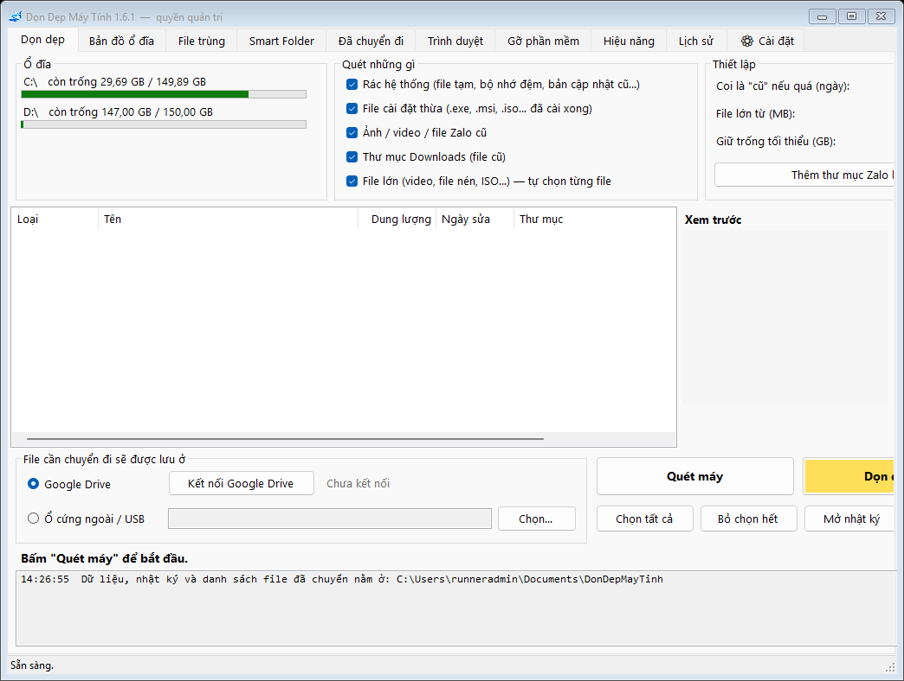
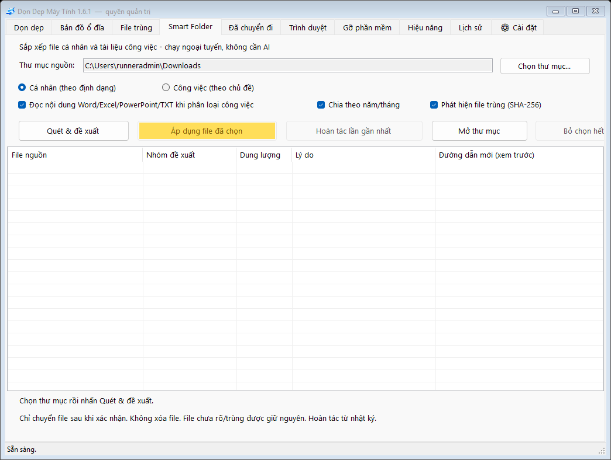
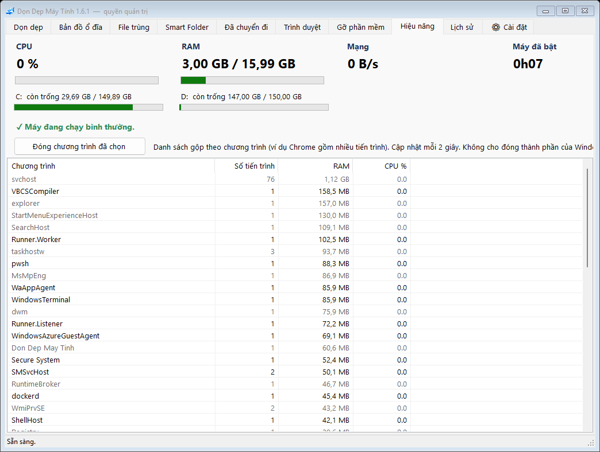
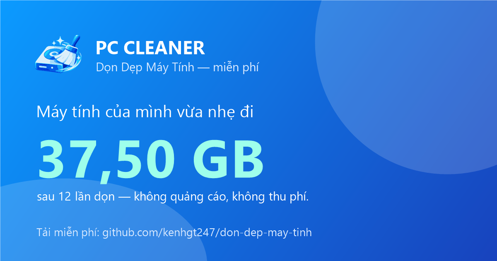
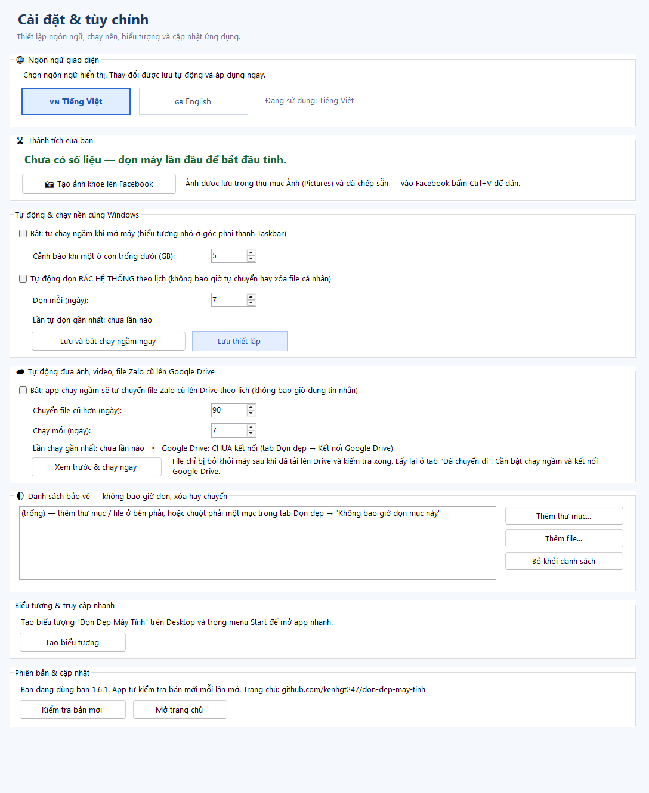
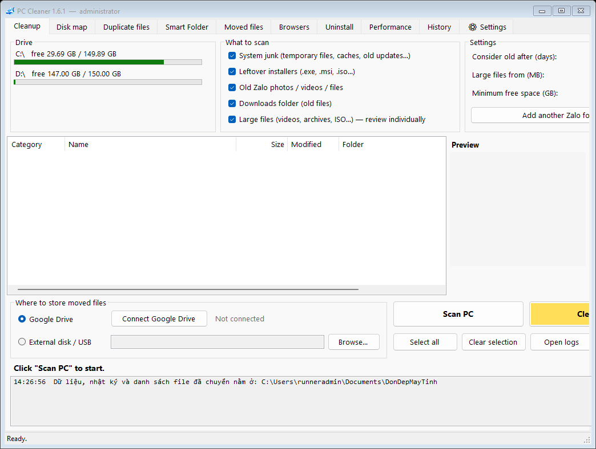

# PC CLEANER
### DỌN DẸP MÁY TÍNH

**Bộ công cụ dọn dẹp, phân tích ổ cứng & quản lý dữ liệu dành cho Windows**

*Free, open-source disk cleanup and storage management for Windows.*

  
  

  
  

  

[🇻🇳 Giới thiệu](#-giới-thiệu) ·
[✨ 10 chức năng](#-10-chức-năng) ·
[⬇️ Tải về](#️-tải-về--cài-đặt) ·
[🛡️ An toàn](#️-an-toàn-dữ-liệu) ·
[🇬🇧 English](#-english)

---

## 🇻🇳 Giới thiệu

**PC Cleaner (Dọn Dẹp Máy Tính)** là phần mềm **miễn phí, mã nguồn mở** giúp máy Windows hết cảnh **ổ C đầy**: dọn rác, tìm thứ đang chiếm chỗ, gỡ phần mềm không dùng, và chuyển bớt ảnh/video lên **Google Drive** hoặc **ổ cứng ngoài** — luôn cho bạn **xem trước và tự quyết định**.

- 💚 **Miễn phí hoàn toàn** — không quảng cáo, không gói VIP, không cần tài khoản.
- 🇻🇳 **Làm cho người Việt** — hiểu Zalo, CapCut, Cốc Cốc; giao diện **Tiếng Việt / English**.
- 🛡️ **An toàn trước tiên** — chặn thư mục hệ thống và tin nhắn Zalo, hỏi lại trước mỗi việc quan trọng, có **danh sách bảo vệ** và **lịch sử** mọi thao tác.
- 🔄 **Tự cập nhật** — có bản mới, app tự tải, kiểm tra và thay thế.
- 🪶 **Gọn nhẹ** — một file `.exe` dưới 1 MB, không cần cài thêm gì.

## ✨ 10 chức năng

| | Tab | Làm được gì |
|:-:|---|---|
| 🧹 | **Dọn dẹp** | Quét **rác hệ thống** (file tạm, thùng rác, gói cập nhật cũ, bộ nhớ đệm trình duyệt / Zalo / Teams), bộ nhớ đệm **CapCut** (kể cả bản CapCut cũ), **Telegram, Messenger, Discord, Adobe, Steam, Epic**; **file cài đặt thừa** (.exe, .msi, .iso ở Downloads, Desktop, thư mục Zalo / Telegram); **ảnh/video Zalo cũ**; file cũ trong **Downloads**; **file lớn**. Với file cá nhân, chọn từng file: **chuyển lên Drive / ổ ngoài** hay **xóa vĩnh viễn**. |
| 🗺️ | **Bản đồ ổ đĩa** | Thư mục nào chiếm nhiều chỗ nhất, đi sâu từng cấp. Bấm vào là biết **đó là gì, có xóa được không**. Chuột phải để xóa (Thùng rác / vĩnh viễn) hoặc chuyển đi. |
| 🧩 | **File trùng** | Tìm file giống hệt nhau, giữ lại 1 bản, bản thừa vào Thùng rác. |
| 📁 | **Smart Folder** | Tự sắp xếp file **cá nhân** (theo loại) hoặc **công việc** (công văn, quyết định, báo cáo, hợp đồng… — đọc cả nội dung Word/Excel/PowerPoint). Chạy hoàn toàn trên máy, không AI, không gửi dữ liệu đi. Xem trước, **hoàn tác** được. |
| ☁️ | **Đã chuyển đi** | Danh sách file đã chuyển lên Drive / ổ ngoài; lấy về đúng chỗ cũ bất cứ lúc nào. |
| 🌍 | **Trình duyệt** | Chrome, Edge, **Cốc Cốc**, Brave, Opera, Firefox — theo từng tài khoản: dọn bộ nhớ đệm, lịch sử, cookie. **Không đụng mật khẩu, dấu trang, tiện ích.** |
| 🧰 | **Gỡ phần mềm** | Phần mềm đã cài theo **dung lượng**, ngày cài, **lần mở gần nhất**; đánh dấu phần mềm hơn 6 tháng chưa mở; gỡ ngay trong app, gỡ xong **dọn luôn tàn dư** còn sót. |
| 📈 | **Hiệu năng** | CPU, RAM, mạng, ổ đĩa theo thời gian thực; chương trình nào đang ngốn máy; đóng chương trình ngay trong app. |
| 🕘 | **Lịch sử** | Mọi lần dọn, xóa, chuyển, gỡ đều được ghi lại kèm danh sách file. |
| ⚙️ | **Cài đặt** | Đổi ngôn ngữ · **"App đã giúp bạn giải phóng X GB"** + ảnh khoe Facebook · chạy ngầm, báo ổ sắp đầy, **tự dọn rác theo lịch** · **tự đưa ảnh Zalo cũ lên Google Drive theo lịch** · **danh sách bảo vệ** · biểu tượng Desktop · cập nhật. |

<table>
<tr>
<td width="50%"> 📁 Smart Folder — sắp xếp file không cần AI</td>
<td width="50%"> 📈 Hiệu năng — CPU, RAM, chương trình ngốn máy</td>
</tr>
<tr>
<td width="50%"> 🏆 Ảnh khoe lên Facebook — tạo bằng một nút bấm</td>
<td width="50%"> ⚙️ Cài đặt — tự động hóa, danh sách bảo vệ, ngôn ngữ</td>
</tr>
</table>

### ☁️ Ảnh Zalo đầy máy? Đưa lên Google Drive

Zalo lưu toàn bộ ảnh, video, file nhận được ngay trên máy nên ổ C đầy rất nhanh. PC Cleaner tìm các file Zalo cũ (ví dụ hơn 90 ngày) và chuyển lên **Google Drive của chính bạn** — bằng tay, hoặc **tự động theo lịch** khi app chạy ngầm. File chỉ bị bỏ khỏi máy **sau khi đã tải lên và kiểm tra xong**; lấy lại bất cứ lúc nào ở tab *Đã chuyển đi*. **Tin nhắn Zalo không bao giờ bị đụng tới.**

## ⬇️ Tải về & cài đặt

### [⬇️ TẢI BẢN MỚI NHẤT](https://github.com/kenhgt247/don-dep-may-tinh/releases/latest)

1. Mở trang **[Releases](https://github.com/kenhgt247/don-dep-may-tinh/releases/latest)**, tải file **`DonDepMayTinh.zip`** ở mục *Assets*.
2. **Giải nén** (ví dụ ra Desktop) — đừng chạy trực tiếp trong file .zip.
3. Bấm đúp **`Don Dep May Tinh.exe`**. Nếu Windows hiện màn hình xanh *"Windows protected your PC"*: bấm **More info → Run anyway**.
4. Muốn có biểu tượng trên Desktop: tab **⚙ Cài đặt → Tạo biểu tượng**.

Chạy trên **Windows 10 / 11** (.NET Framework 4.8 có sẵn trong Windows). Hướng dẫn chi tiết nằm trong file `HUONG DAN.txt` (tiếng Việt) và `GUIDE (English).txt` trong gói tải về.

> **Vì sao Windows cảnh báo?** File `.exe` chưa có chữ ký số (dự án mới, sẽ đăng ký khi có nhiều người dùng). Toàn bộ mã nguồn công khai trong [`src/`](src/) — ai cũng kiểm tra được. Chỉ tải từ trang Releases chính thức. Xem [chính sách ký số](CODE_SIGNING_POLICY.md).

## 🛡️ An toàn dữ liệu

- **Không làm gì khi bạn chưa bấm Yes.** Bảng xác nhận cho biết sẽ xóa gì, chuyển gì, ổ còn trống bao nhiêu sau khi dọn. Xóa vĩnh viễn file cá nhân phải xác nhận 2 lần.
- **Chặn thư mục nguy hiểm:** Windows, chương trình đã cài, dữ liệu tin nhắn Zalo, thư mục OneDrive / Google Drive, thư mục phần mềm / game.
- **Chép xong mới xóa:** file chỉ bị bỏ khỏi máy sau khi bản sao trên Drive / ổ ngoài đã kiểm tra đúng. Không đủ chỗ thì không cho chuyển.
- **Danh sách bảo vệ:** thư mục / file bạn đánh dấu sẽ không bao giờ bị dọn, xóa hay chuyển — kể cả khi app tự chạy theo lịch.
- **Phần mềm đang mở** (Zalo, CapCut, Telegram, trình duyệt…) thì app nhắc tắt trước khi dọn bộ nhớ đệm của nó.
- **Lịch sử** ghi lại mọi thao tác; nhật ký chi tiết ở `Documents\DonDepMayTinh`.
- **Google Drive:** app dùng công cụ mã nguồn mở [rclone](https://rclone.org) với quyền `drive.file` — **chỉ thấy file do chính nó tải lên**, không đọc được các file khác trong Drive của bạn. Dữ liệu đi thẳng vào Drive của bạn, không qua máy chủ nào của dự án. Xem [chính sách quyền riêng tư](PRIVACY.md).

## 💬 Câu chuyện dự án

> Tôi quá khó chịu vì ổ cứng lúc nào cũng đầy — máy chậm, Zalo không mở được, lưu file lại báo hết chỗ. Nhiều công cụ dọn rác xóa quá khó kiểm soát hoặc phải trả phí. Vì vậy, tôi tự làm một công cụ dễ hiểu, cho phép **xem trước và tự quyết định**, rồi chia sẻ miễn phí với mọi người.

⭐ Thấy hữu ích? Bấm **Star** ở góc trên bên phải để ủng hộ dự án. Gặp lỗi hoặc muốn thêm tính năng: vào **[Issues](https://github.com/kenhgt247/don-dep-may-tinh/issues)** → **New issue** (ghi phiên bản Windows, phiên bản app, các bước gặp lỗi; kèm ảnh chụp nếu được).

---

## 🇬🇧 English

**PC Cleaner** is a **free, open-source disk cleanup and storage toolkit for Windows 10/11**, built with C# / Windows Forms. It always shows you what it will do and asks before acting.

| Tab | What it does |
|---|---|
| 🧹 **Cleanup** | System junk, browser/Zalo/Teams caches, **CapCut, Telegram, Messenger, Discord, Adobe, Steam, Epic** caches, **leftover installers**, old Zalo media, old Downloads, large files. Personal files: move to Drive / external disk or delete permanently, file by file. |
| 🗺️ **Disk map** | See what uses the space, with a plain-language safety label for every folder. |
| 🧩 **Duplicates** | Identical files; keeps one copy, extras go to the Recycle Bin. |
| 📁 **Smart Folder** | Offline, rule-based organizer for personal and work files, with preview and undo. No AI, no uploads. |
| ☁️ **Moved files** | Restore anything moved to Drive / external disk. |
| 🌍 **Browsers** | Cache, history, cookies per profile (Chrome, Edge, Cốc Cốc, Brave, Opera, Firefox). Passwords, bookmarks and extensions are never touched. |
| 🧰 **Uninstall** | Programs by size and estimated last use; runs the program's own uninstaller, then offers to remove leftover folders. |
| 📈 **Performance** | Live CPU, memory, network, disks and the heaviest programs. |
| 🕘 **History** | Every cleanup, deletion, move and uninstall, with file-level details. |
| ⚙️ **Settings** | Language · "space freed" counter with a shareable picture · tray mode, low-disk alerts, scheduled junk cleanup · **scheduled upload of old Zalo media to your Google Drive** · protected list · shortcuts · **self-update** (SHA-256 verified). |

**Download:** [Latest release](https://github.com/kenhgt247/don-dep-may-tinh/releases/latest) → `DonDepMayTinh.zip` → extract → run `Don Dep May Tinh.exe`. Switch language in **⚙ Settings**. Releases are currently unsigned, so SmartScreen may warn on first launch.

## 🧑‍💻 Dành cho nhà phát triển / For developers

| | |
|---|---|
| **Source** | [`src/`](src/) — C# · Windows Forms · .NET Framework 4.8 |
| **Build** | `dotnet build src/DonDepMayTinh.csproj -c Release` |
| **Tests** | `--selftest` (VI) · `--selftest-en` (EN) · `--screens <folder>` (UI screenshots) |
| **CI** | [GitHub Actions](https://github.com/kenhgt247/don-dep-may-tinh/actions) — Windows build + bilingual self-tests on every change |
| **Release** | Bump `Version` in `src/Core.cs` and `src/DonDepMayTinh.csproj` → **Actions → Đóng gói và phát hành → Run workflow** |
| **License** | [MIT](LICENSE) · [Privacy](PRIVACY.md) · [Code signing policy](CODE_SIGNING_POLICY.md) |

---

**PC CLEANER — Dọn máy gọn gàng, dữ liệu trong tầm kiểm soát.**

*Clean smarter. Keep what matters.*

[⬇️ Tải về / Download](https://github.com/kenhgt247/don-dep-may-tinh/releases/latest) ·
[🐛 Báo lỗi / Report an issue](https://github.com/kenhgt247/don-dep-may-tinh/issues) ·
[⭐ Star](https://github.com/kenhgt247/don-dep-may-tinh)

**© kenhgt247 · [MIT License](LICENSE)**

